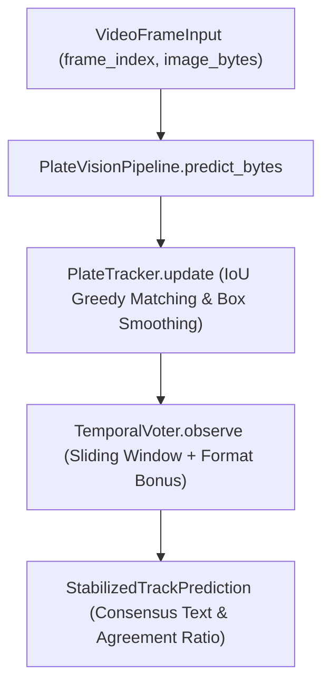
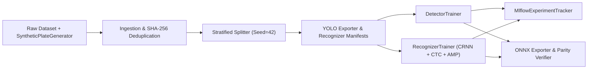

# System Architecture

Plate-Vision is designed around explicit protocol boundaries (`PlateDetectorProtocol`, `PlateRecognizerProtocol`, `CountryProfileProtocol`, `MultiObjectTrackerProtocol`, `DatasetStorageProtocol`, `ExperimentTrackerProtocol`) following SOLID and DRY principles.

## End-to-End Inference Architecture

```mermaid
flowchart LR
    A["Input Image / Frame Bytes"] --> B["Payload & MIME Validator"]
    B --> C["Grayscale / Tensor Decoder"]
    C --> D["OnnxDetectorRuntime (YOLO)"]
    D --> E["Non-Maximum Suppression"]
    E --> F["4-Point Perspective Rectification"]
    F --> G["Low-Light & Blur Normalization"]
    G --> H["OnnxRecognizerRuntime (CRNN)"]
    H --> I["CTC Beam Search Decoder"]
    I --> J["CountryProfile Post-Processor"]
    J --> K["PlatePredictionResult"]
```

## Video Multi-Object Tracking and Temporal Voting

## Training and Experiment Tracking Pipeline

## Component Responsibilities

1. **`plate_vision.config`**: Loads strongly typed configuration from YAML files and `PLATE_VISION_*` environment variables.
2. **`plate_vision.data`**: Validates binary image headers (`PNG`, `JPEG`, `WebP`), eliminates content duplicates via SHA-256 hashes, performs stratified splits by province prefix, generates synthetic license plate crops, and applies configurable training augmentations.
3. **`plate_vision.detection`**: Trains and evaluates the plate detector, computing precision, recall, `mAP@0.5`, and `mAP@0.5:0.95`.
4. **`plate_vision.recognition`**: Implements the CRNN sequence model, `CharsetEncoder`, `ctc_greedy_decode`, `ctc_beam_search_decode`, `SeededDataLoader`, and `RecognizerTrainer`.
5. **`plate_vision.pipeline`**: Orchestrates two-stage detection and recognition with perspective deskewing, crop normalization, country regex validation, optical confusion correction, and timeout enforcement.
6. **`plate_vision.export`**: Exports detector and recognizer checkpoints to ONNX, verifies numerical equivalence (`ParityReport`), and performs dynamic `int8` weight quantization.
7. **`plate_vision.serving`**: Serves ONNX models via FastAPI with `/v1/predict`, `/v1/predict/upload`, `/v1/predict/batch`, `/healthz`, `/readyz`, and `/metrics`.
8. **`plate_vision.video`**: Tracks multiple plates across video frames and stabilizes OCR output via temporal voting.
