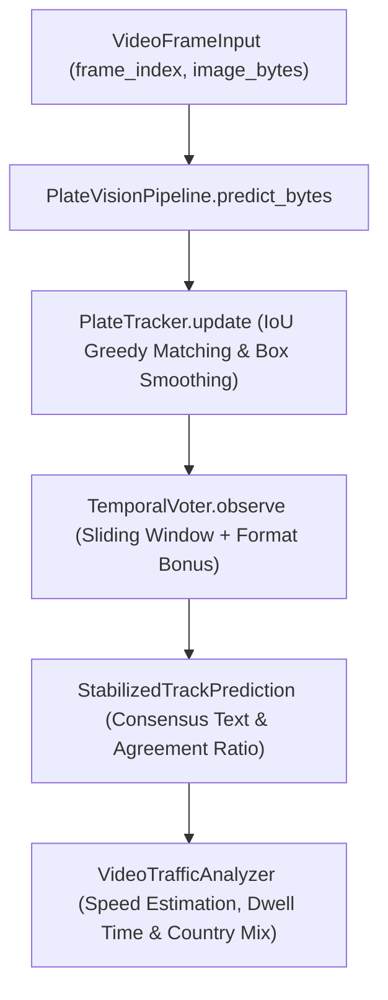
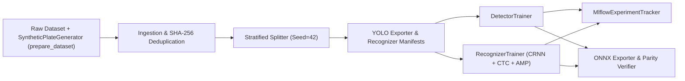

# System Architecture

Plate-Vision is designed around explicit protocol boundaries (`PlateDetectorProtocol`, `PlateRecognizerProtocol`, `CountryProfileProtocol`, `MultiObjectTrackerProtocol`, `DatasetStorageProtocol`, `ExperimentTrackerProtocol`, `PredictionStorageProtocol`) following SOLID and DRY principles.

## End-to-End Inference Architecture

```mermaid
flowchart LR
    A["Input Image / Frame Bytes"] --> B["Payload & MIME Validator"]
    B --> C["Grayscale / Tensor Decoder"]
    C --> D["OnnxDetectorRuntime (YOLO)"]
    D --> E["Non-Maximum Suppression"]
    E --> F["4-Point Perspective Rectification"]
    F --> G["Low-Light & Blur Normalization"]
    G --> H["OnnxRecognizerRuntime (CRNN)"]
    H --> I["CTC Beam Search Decoder"]
    I --> J["CountryProfile / MultiCountry Post-Processor"]
    J --> K["PlatePredictionResult & Audit Storage"]
```

## Video Multi-Object Tracking and Analytics

## Training and Experiment Tracking Pipeline

## Component Responsibilities

1. **`plate_vision.config`**: Loads strongly typed configuration from YAML files and `PLATE_VISION_*` environment variables.
2. **`plate_vision.data`**: Validates binary image headers (`PNG`, `JPEG`, `WebP`), eliminates duplicates via SHA-256 hashes, performs stratified splits, synthesizes plates across 8 registered country profiles (`TR`, `DE`, `GB`, `AZ`, `FR`, `IT`, `ES`, `NL`), mines uncertain production samples via `ActiveLearningSampler`, and orchestrates end-to-end preparation via `prepare_dataset`.
3. **`plate_vision.detection`**: Trains and evaluates the plate detector (`train_detector`), computing precision, recall, `mAP@0.5`, and `mAP@0.5:0.95`.
4. **`plate_vision.recognition`**: Implements the CRNN sequence model, `CharsetEncoder`, `ctc_greedy_decode`, `ctc_beam_search_decode`, `SeededDataLoader`, and `RecognizerTrainer` (`train_recognizer`).
5. **`plate_vision.pipeline`**: Orchestrates two-stage detection and recognition (`predict_plate`) with perspective deskewing, crop normalization, country/multi-country regex post-processing (`MultiCountryPostProcessor`), GDPR privacy redaction (`redact_regions`), watchlist matching (`WatchlistMatcher`), content-addressable LRU caching (`PredictionCache`), and timeout enforcement.
6. **`plate_vision.evaluation`**: Computes detector, recognizer, and end-to-end metrics (`evaluate_pipeline`), exports error-analysis artifacts, calibrates confidences (`compute_expected_calibration_error`, `TemperatureScaler`), and detects covariate/prediction shift (`compute_population_stability_index`, `DriftDetector`).
7. **`plate_vision.export`**: Exports detector and recognizer checkpoints to ONNX (`export_models`), verifies numerical parity (`ParityReport`), and performs dynamic `int8` weight quantization.
8. **`plate_vision.serving`**: Serves ONNX models via FastAPI (`/v1/predict`, `/v1/predict/upload`, `/v1/predict/batch`, `/v1/predict/video`, `/v1/audit/recent`, `/v1/watchlist/check`, `/v1/monitoring/drift`, `/healthz`, `/readyz`, `/metrics`) with `X-API-Key` authentication, `SlidingWindowRateLimiter`, and `X-Request-ID` tracing.
9. **`plate_vision.video`**: Tracks multiple plates across frames (`PlateTracker`), stabilizes OCR via temporal voting (`TemporalVoter`), and computes calibrated vehicle speed, dwell time, and country distributions (`VideoTrafficAnalyzer`).
10. **`plate_vision.utils`**: Structured logging, exception hierarchy, MLflow tracking, semantic release helpers, SHA-256 LRU cache (`PredictionCache`), and durable audit stores (`InMemoryPredictionStore`, `LocalJsonlPredictionStore`, `SqlitePredictionStore`).
